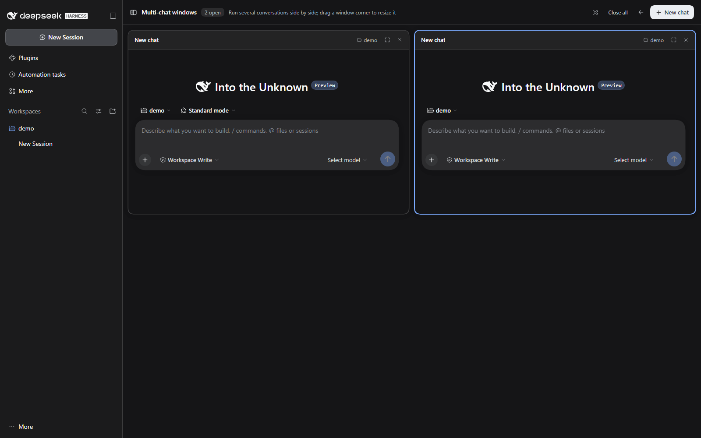

# dsh-multichat

[](https://www.npmjs.com/package/dsh-multichat)
[](LICENSE)

Run up to **16 live conversations side by side** in the DeepSeek Harness Web GUI.

Open it from the split-view button at the **top-right of the conversation header**, add windows with **＋ New chat**, and drag any window's bottom-right corner to resize it. Every window is the real Harness conversation surface — hero, transcript, composer, approvals and streaming included — not a simplified reimplementation.



> This is an unofficial community plugin. It is not affiliated with or endorsed by DeepSeek.

## Features

- **Native chat in every window.** Each window reuses the shipped Conversation component factory (`conversation.content`, embedded variant), so drafts, attachments, tool cards, approvals, streaming and session history behave exactly like the main conversation.
- **Top-right entry, no sidebar clutter.** A single split-view icon appears in the conversation header. Click it to open the panel with the current conversation; open another conversation and click again to add that one to the split view.
- **Up to 16 windows.** The add button disables itself at 16 and explains why in its tooltip.
- **Free resize.** Drag a window's bottom-right corner to change its width and height; double-click the corner to reset that window. The toolbar's reset action clears every custom size.
- **Open, close, expand, close all.** Close a window without losing its session, or expand a window into the full conversation view.
- **Light and dark themes** through DSH theme tokens, plus Chinese and English UI copy.
- **No telemetry, no network requests.** The plugin only talks to the local Harness UI.

## Requirements

- DeepSeek Harness `0.2.2-rc.1` or a compatible `0.2.x` release. The package declares `engines.dsh` so the Plugin Manager can refuse incompatible hosts.
- The Harness **Web UI** (desktop app or `dsh web`). This is a browser plugin; it does not apply to `headless` or `tui` profiles.

## Install

### From the Plugin Manager (recommended)

1. Open **Plugins** in the DSH sidebar.
2. Choose **Add plugin** → **Install a third-party plugin**.
3. Enter `dsh-multichat` and confirm the installation.
4. Open an existing conversation and click the split-view button at the top-right of the header.

The registry field also accepts an explicit version (`dsh-multichat@0.1.0`), a Git address, a tarball, or an absolute path to a local checkout.

### From an agent

Ask your DSH agent to install the package with the plugin manager, or run the equivalent `plugin_manager` `install_bundle` action with target `dsh-multichat`.

### From source

```bash
git clone https://github.com/lihang212010/dsh-multichat.git
```

In the Plugin Manager, choose **Install a third-party plugin** and enter the absolute path of the checkout. The Host links the directory, so edits are picked up without copying files.

## Usage

1. Open a conversation that already has at least one message.
2. Click the **split-view icon** at the top-right of the conversation header.
3. Click **＋ New chat** to add windows. Each new window creates a blank session in the current (or most recently used) workspace.
4. Window header actions:
   - **Expand** — open that session in the full conversation view.
   - **Close** — remove the window; the session stays in the sidebar history.
5. Panel toolbar:
   - **Reset pane sizes** — drop every custom width/height.
   - **Close all** — empty the split view.
   - **Back** — return to the regular conversation view.
6. Drag a window's **bottom-right corner** to resize it. The handle appears on hover and the corner tooltip explains the gesture.

> DSH hides the header utility area for **blank sessions**. Right after “New Session” with no message yet, the multi-chat button is not visible; send the first message or open an existing session to reveal it.

## How it works

The package is a normal DSH bundle with a browser half:

- `package.json` declares `dsh.bundle.patch` and `dsh.client` (`platform: web`, `immediately: true`).
- `cordis.patch.yml` inserts the Host row that carries the bundle.
- `client.js` registers:
  - the `main` panel `multichat`, with a session-scoped child slot `multichat.pane`;
  - the `conversation.session.header.utilities` button;
  - one `SessionProvider` per window, bound to a Session reference retained with the `multichat` retention source;
  - the shipped `conversation.content` factory inside each window.

Pane identity and sizes are stored in `localStorage` under `dsh.multichat.panes.v2` (the previous `...v1` key is migrated automatically). The Host owns the session log; the plugin never writes session events.

Because the panel is a global `main` panel, opening it does not disturb the sidebar, the right sidebar, or session history.

## Compatibility and maintenance

Tested with DeepSeek Harness `0.2.2-rc.1` (client commit `c59d10a`) on Windows desktop, with the `web` bundle.

This plugin intentionally uses a small set of Harness client contracts:

- the `main` keyed slot and its `entryKey` rendering;
- the `conversation.content` Component Factory with the `embedded` variant;
- `SessionProvider` and the `conversation.session.header.utilities` slot;
- `ctx.layout`, `ctx.sessions`, `ctx.uiWorkspace` and `ctx.locale`.

These are internal APIs of the current DSH line. A Harness upgrade may change them; when that happens the plugin needs a matching release. Bug reports with the Harness version and the browser console output are welcome.

## Privacy

- No analytics, telemetry, remote requests or background processes.
- The plugin reads Session data only through the same client services the UI already uses.
- Pane layout is stored locally in the browser origin; deleting site data resets it.
- Conversation content remains in DSH's normal session storage, untouched.

## Development

There is no build step: `client.js` is the browser bundle and `index.js` is the (empty) Host half.

```bash
npm test        # manifest / bundle consistency checks
npm pack --dry-run
```

Local loop:

1. Install the checkout through **Plugins → Add plugin → local directory**.
2. Edit `client.js`.
3. The Host detects the new bundle revision and pushes it to the open page; refresh once if the page does not pick it up.
4. Run through the checklist in [CONTRIBUTING.md](CONTRIBUTING.md) before opening a pull request.

## License

[MIT](LICENSE)
