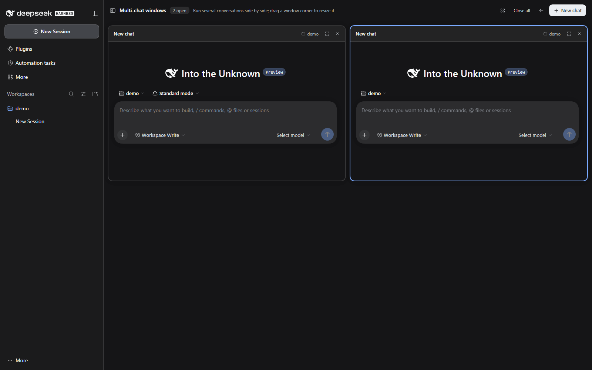

# dsh-multichat

[](https://www.npmjs.com/package/dsh-multichat)
[](LICENSE)

在 DeepSeek Harness Web GUI 中并排运行最多 **16 个真实对话窗口**。

入口位于**对话页右上角**的分屏按钮；点击 **＋ 新建对话** 新增窗口，拖动任意窗口右下角即可自由调整大小。每个窗口都是 Harness 原生对话界面（Hero、消息流、输入框、审批、流式输出），不是简化的复刻。



> 这是社区第三方插件，与 DeepSeek 官方无关，也未获得官方背书。

## 特性

- **每个窗口都是原生对话**：复用官方 Conversation Component Factory（`conversation.content` 的 `embedded` 变体），草稿、附件、工具卡片、审批、流式输出、会话历史与主对话完全一致。
- **入口在右上角**：对话头部右侧一个分屏图标，不占用左侧栏。点一次把当前会话放进分屏；切到另一个会话再点一次，即可把它追加进同一个分屏。
- **最多 16 个窗口**：到上限后「新建对话」自动禁用，并在提示中说明原因。
- **自由缩放**：拖动窗口右下角调整宽高；双击右下角恢复该窗口默认大小；工具栏「恢复等分大小」清除全部自定义尺寸。
- **展开 / 关闭 / 全部关闭**：关闭窗口不会删除会话，仍可在左侧栏历史中找到；展开则回到完整对话页。
- **明暗主题**：全部使用 DSH 主题令牌；中英文文案。
- **无遥测、无网络请求**：插件只与本机 Harness UI 通信。

## 环境要求

- DeepSeek Harness `0.2.2-rc.1` 或兼容的 `0.2.x` 版本。包内声明了 `engines.dsh`，不兼容的 Host 会被 Plugin Manager 拒绝。
- Harness **Web UI**（桌面端或 `dsh web`）。这是浏览器插件，不适用于 `headless` / `tui` profile。

## 安装

### 通过 Plugin Manager（推荐）

1. 打开左侧栏 **插件**。
2. 选择 **添加插件** → **安装第三方插件**。
3. 输入 `dsh-multichat` 并确认。
4. 打开一个已有对话，点击头部右上角的分屏按钮。

安装对话框也支持带版本号（`dsh-multichat@0.1.0`）、Git 地址、tarball 或本地目录绝对路径。

### 通过智能体

让 DSH 智能体使用插件管理器安装该包，或调用等价的 `plugin_manager` `install_bundle`，target 为 `dsh-multichat`。

### 从源码

```bash
git clone https://github.com/lihang212010/dsh-multichat.git
```

在 Plugin Manager 中选择 **安装第三方插件**，输入该目录的绝对路径。Host 会以链接方式安装，修改源码后无需复制文件。

## 使用

1. 打开一个已有消息的对话。
2. 点击头部右上角的**分屏图标**。
3. 点击 **＋ 新建对话** 添加窗口；新窗口会在当前（或最近使用的）工作区创建一个空白会话。
4. 窗口头部操作：
   - **展开**：在完整对话页中打开该会话；
   - **关闭**：关闭窗口，会话保留在左侧栏历史中。
5. 面板工具栏：
   - **恢复等分大小**：清除所有自定义尺寸；
   - **全部关闭**：清空分屏；
   - **返回对话**：回到普通对话页。
6. 拖动窗口**右下角**调整大小；手柄在悬停时出现，并带有说明提示。

> Harness 会隐藏**空白会话**的头部工具区。刚点“新会话”还没发消息时看不到分屏按钮；发送首条消息或打开已有会话后即可看到。

## 实现

这是一个普通 DSH bundle，包含一个浏览器端插件：

- `package.json` 声明 `dsh.bundle.patch` 与 `dsh.client`（`platform: web`、`immediately: true`）。
- `cordis.patch.yml` 插入承载该 bundle 的 Host 行。
- `client.js` 注册：
  - `main` 面板 `multichat`，带一个 session 作用域的子槽 `multichat.pane`；
  - `conversation.session.header.utilities` 右上角按钮；
  - 每个窗口一个 `SessionProvider`，绑定以 `multichat` 为 retention source 保留的会话引用；
  - 窗口内部渲染官方 `conversation.content` factory。

窗口列表和尺寸保存在 `localStorage` 的 `dsh.multichat.panes.v2`（会自动迁移旧的 `...v1`）。会话日志仍由 Host 拥有，插件不写入任何会话事件。

## 兼容性与维护

已在 DeepSeek Harness `0.2.2-rc.1`（客户端 commit `c59d10a`）的 Windows 桌面端 + `web` bundle 上测试。

插件使用了少量 Harness 客户端内部契约：

- `main` keyed slot 及其 `entryKey` 渲染；
- `conversation.content` Component Factory 的 `embedded` 变体；
- `SessionProvider` 与 `conversation.session.header.utilities` 插槽；
- `ctx.layout`、`ctx.sessions`、`ctx.uiWorkspace`、`ctx.locale`。

这些是当前 DSH 版本的内部 API；Harness 升级可能改变它们，届时插件需要发布适配版本。提交问题时请附上 Harness 版本和浏览器控制台输出。

## 隐私

- 无统计、遥测、远程请求或后台进程。
- 插件通过 UI 已有的客户端服务读取会话数据。
- 窗口布局仅存于浏览器本地；清除站点数据即可重置。
- 对话内容仍在 DSH 正常的会话存储中，插件不会修改。

## 开发

没有构建步骤：`client.js` 即浏览器 bundle，`index.js` 是（空的）Host 半边。

```bash
npm test        # 清单 / bundle 一致性检查
npm pack --dry-run
```

本地开发流程：

1. 通过 **插件 → 添加插件 → 本地目录** 安装该目录；
2. 修改 `client.js`；
3. Host 检测到新的 bundle revision 后会推送到已打开的页面；若未生效，刷新一次；
4. 按 [CONTRIBUTING.md](CONTRIBUTING.md) 的检查清单自测后再提 PR。

## 许可证

[MIT](LICENSE)
